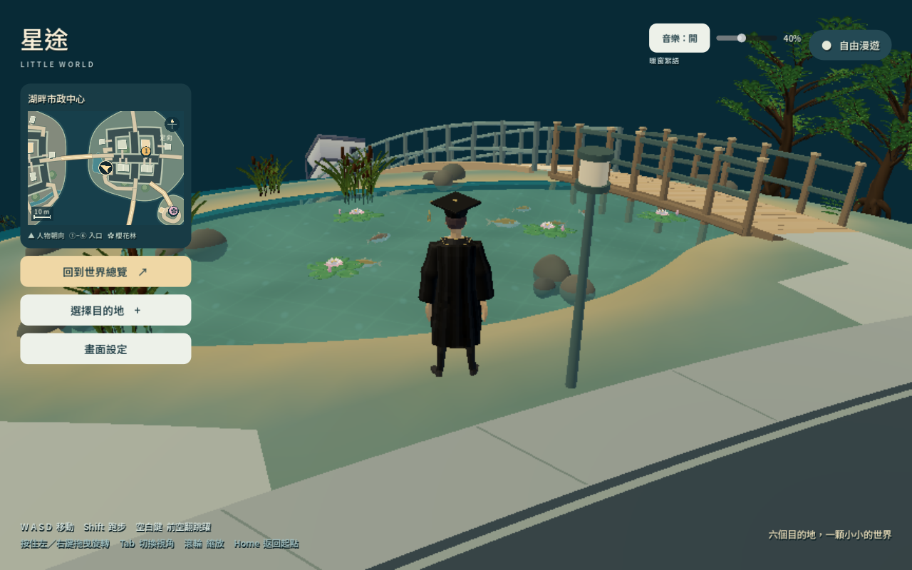
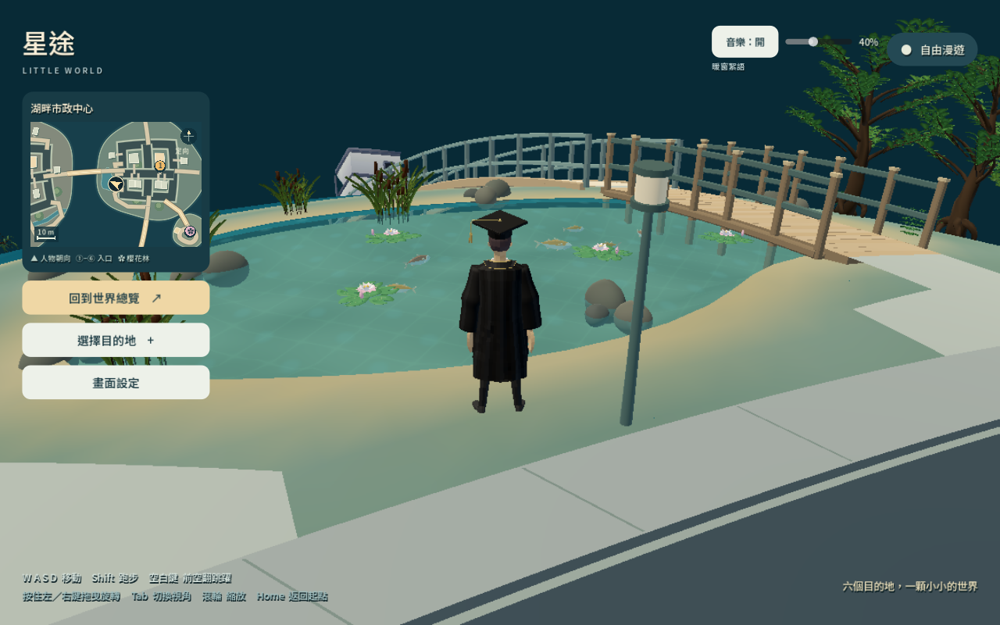

# 畫質提升與手機負荷評估

更新日期：2026-10-10。目標：改善整體光線、水面與畫面清晰度，同時為 iPhone 11 等較舊手機保留可降低負荷的設定。

已改善光線、水面與手機清晰度，並加入依流暢度調整解析度的手機模式。最新桌機原生與 Chrome 硬體渲染檢查維持約 30 FPS；相同場景的繪製次數與圖元數量沒有增加。**目前沒有 iPhone 11 Safari 真機測試，尚不能保證長時間流暢、溫升或記憶體安全。**

## 這次改善了什麼

- **光線層次**：調整戶外環境光、暖色主光與冷色補光，改善物件的明暗與色彩分離。
- **水面細節**：調整海面色調與波紋、湖水高光，依波紋在畫面中佔的像素抑制過細的閃動。湖水保留看得見湖底、魚與水生植物的透明度。
- **手機清晰模式**：新手機首次開啟預設使用「手機清晰」與 30 FPS。3D 從最高 540p 起步，依持續遊玩時的流暢度，在 432p、540p、630p、720p 間調整；穩定後逐級嘗試更清晰的畫面，負荷持續過高時降一級。文字與介面維持原解析度。
- **避免錯判**：背景、開啟設定、轉場與內容準備期間不作升畫質依據；已選的 FPS 上限由玩家獨立控制。iPad 桌面模式的辨識也已補齊，避免套用桌機預設。
- **更可信的效能讀數**：幀時間改用實際時鐘，保留真實長卡頓；背景與室內外場景切換重置採樣。發行版不可用的記憶體數值有明確標註，另外提供貼圖與渲染記憶體計數。

已有玩家的畫質偏好會保留；可在「畫面設定」選「手機清晰」，或恢復預設套用新的手機預設。

同一水岸視角的桌機原生畫面；對比包含光線、水面及解析度變化：

| 修改前 | 修改後 |
|---|---|
|  |  |

## iPhone 11 建議怎麼設定

| 選項 | 建議用途 | 主要取捨 |
|---|---|---|
| 手機清晰＋30 FPS | 預設起點，適合先在真機驗證 | 自動在 432–720p 調節；保留手機用的遠景、植被與陰影限制 |
| 手機省電＋30 FPS | 想固定較低負荷、長時間遊玩 | 3D 固定最高 540p；不自動升解析度 |
| 一般 | 經真機驗證有足夠餘裕才使用 | 原解析度、2× MSAA、戶外陰影，負荷較高 |

手機清晰與手機省電在選擇檔位時預設關閉 MSAA 與戶外即時陰影；玩家仍可手動調整抗鋸齒。解析度是上限，實際寬高依螢幕比例與瀏覽器可用區域而定。

同一畫面比例下，720p 比 540p 多約 **78% 的 3D 像素**，因此不直接把所有手機鎖定最高畫質。自動降低解析度主要緩解像素渲染負荷；角色動畫、場景載入或記憶體造成的問題，仍需要分別處理。新模式會觀察掉幀調節，但不能直接讀取或保證手機的溫度與耗電量。

Apple 確認 iPhone 11 使用 A13、4 核 GPU 與 1792×828 螢幕。Godot 官方同時提醒手機 Web 的 CPU／GPU 資源較吃緊，且 Safari 的 WebGL 相容性仍需驗證。這些資料支持保守預設，不能換算成此遊戲的真機 FPS。[Apple 規格](https://support.apple.com/en-us/111865)、[Godot Web 匯出](https://docs.godotengine.org/en/stable/tutorials/export/exporting_for_web.html)

## 實際量測

原生比較使用 Windows、AMD Radeon RX 5700 XT、Godot 4.7.2 Compatibility、1280×800 視窗與 30 FPS 上限。最新版本包括第二次海面細調。九個位置涵蓋全景、六處水岸、室內及返回戶外，每處約 60 個幀間隔。

| 指標 | 修改前：手機省電 | 最新版本：手機清晰 |
|---|---:|---:|
| 3D 解析度 | 864×540 | 七個戶外位置 1152×720；室內及返回 864×540 |
| 各位置平均 FPS | 30.002–30.019 | 29.991–30.032 |
| 各位置幀間隔 p95 範圍 | 33.379–34.026 ms | 33.519–34.091 ms |
| 九個位置的繪製次數 | 147–510 | 每個對應位置完全相同 |
| 九個位置的渲染圖元計數 | 137,449–889,980 | 每個對應位置完全相同 |

這支持「桌機提高解析度後，場景提交量維持原狀」，不代表著色器成本為零或剩餘 GPU 效能已量出。圖元也不能直接當模型三角形數。[修改前原始記錄](../deliverables/render-quality/before/report.json)、[最新原生記錄](../deliverables/render-quality/final-balanced/report.json)

Chrome 155.0.8059.40 使用同一張 RX 5700 XT 硬體渲染、1280×800 視窗與 30 FPS 上限。以下三個樣本位於相同視角，各約六秒；動畫時間不同會造成少量圖元差異。

| 模式 | 3D 解析度 | 提交頻率 | 提交間隔 p95 | 繪製次數／圖元 | 引擎渲染記憶體 |
|---|---:|---:|---:|---:|---:|
| 手機省電 | 864×540 | 30.01 FPS | 35.0 ms | 319／467,819 | 157.84 MB |
| 手機清晰 | 1152×720 | 30.01 FPS | 34.2 ms | 318／467,115 | 160.74 MB |
| 一般 | 1280×800、2× MSAA | 29.97 FPS | 34.9 ms | 472／784,214 | 170.85 MB |

三個樣本均沒有超過 100 ms 的提交間隔；手機清晰相對手機省電，渲染記憶體計數增加約 2.90 MB。**Web 這裡量的是 CPU 向 WebGL 提交的節奏，並非 GPU 完成／螢幕呈現時間，也不是 iPhone 效能。**「一般」模式多出陰影與較多細節，場景負荷明顯較高。[Web 原始記錄](../deliverables/render-quality/web/report.json)

較早的 [同解析度初輪記錄](../deliverables/render-quality/after-mobile/report.json) 保留供追溯；該輪在第二次海面細調之前，不作最終畫面的結果。

## 記憶體與真機驗收

目前主要需要觀察的是角色布料動畫資料、室內貼圖，以及走過多個區域後留在頁面中的資源包。九點原生路線的室內樣本貼圖計數約 **114.75 MB**、buffer 約 **112.92 MB**；Web 同視角樣本的 buffer 約 **139.57 MB**，已掛載 pack 約 **40.17 MB**。這些數值描述不同的配置範圍，不能相加當作瀏覽器 RAM；已卸載場景也不代表頁面期間保留的 pack 同時消失。

降低解析度不會等比例減少這些資料。`render_video_bytes` 已包含貼圖與 buffer，發行版 `static_memory_available = false` 的數值 0 也不表示沒有使用記憶體。需由真機檢查峰值及反覆遊玩後的趨勢。[Godot Performance](https://docs.godotengine.org/en/stable/classes/class_performance.html)

建議以 **30 FPS、穩態幀間隔 p95 ≤40 ms** 作 iPhone 11 的工程驗收目標，並要求連續 15 分鐘沒有 Safari 自動重載、WebGL context loss 或持續降速。這是待驗收目標，並非已取得的真機結果。

測試順序為冷啟動 → 密集植被與湖畔奔跑／轉鏡 → 重複跳躍 → 室內外往返 → 巡訪不同區域 → 切背景後恢復 → 回到相同路線比較。首次載入卡頓與穩態遊玩分開記錄，並記下 iOS／Safari 版本、電量、充電／低耗電狀態和室溫。完整 15 分鐘表格、資產數據與量測限制見 [手機稽核](../deliverables/render-quality/mobile-audit.md)。

真機可透過 Mac Safari 遠端檢查。記憶體時間軸本身會增加量測負荷，幀率與記憶體建議分開採樣。[WebKit 真機檢查](https://webkit.org/web-inspector/enabling-web-inspector/)、[WebKit Timelines](https://webkit.org/web-inspector/timelines-tab/)

## 驗證範圍

- **Godot 檢查**：共 141 項 assertions（78＋56＋7）通過，包含畫質策略與時鐘採樣；最新原生九個位置記錄無錯誤。
- **Chrome 硬體渲染**：八項檢查通過，包含實際移動、540p 向上調節、720p 上限、設定選單暫停調節、保存設定與記憶體可用性標示；無 shader／引擎／瀏覽器錯誤。
- **手機操作模擬**：交付建置完整 21 項通過、無錯誤，包括 iPad 桌面模式正確套用手機清晰／30 FPS／關閉 MSAA。SwiftShader 模擬只驗證功能，不能用來判定手機硬體負荷。[手機操作原始記錄](../deliverables/mobile-web/mobile-functional.json)
- **室內自動調節**：九點路線的室內／返回樣本維持 540p，原因是測試視窗失焦而暫停採樣。恢復焦點後另測，室內正常升至 1152×720，平均 30.007 FPS、p95 33.646 ms；返回戶外依設計重設為 540p，持續採樣，平均 29.999 FPS、p95 33.927 ms。確認戶外場景暫時移出場景樹時，畫質控制仍正常運作。[室內補測](../deliverables/render-quality/indoor-focused/report.json)
- **iPhone 11 Safari**：尚無真機 15 分鐘結果。

交付建置為 `packs-4077a215b77ef596`。Web 效能記錄採 `packs-63f5a4506ade0a4d`；到交付版僅新增兩個 HUD 按鈕焦點字色設定，著色器與畫質調節策略相同。原始記錄保留各自建置識別，便於核對測試範圍。
